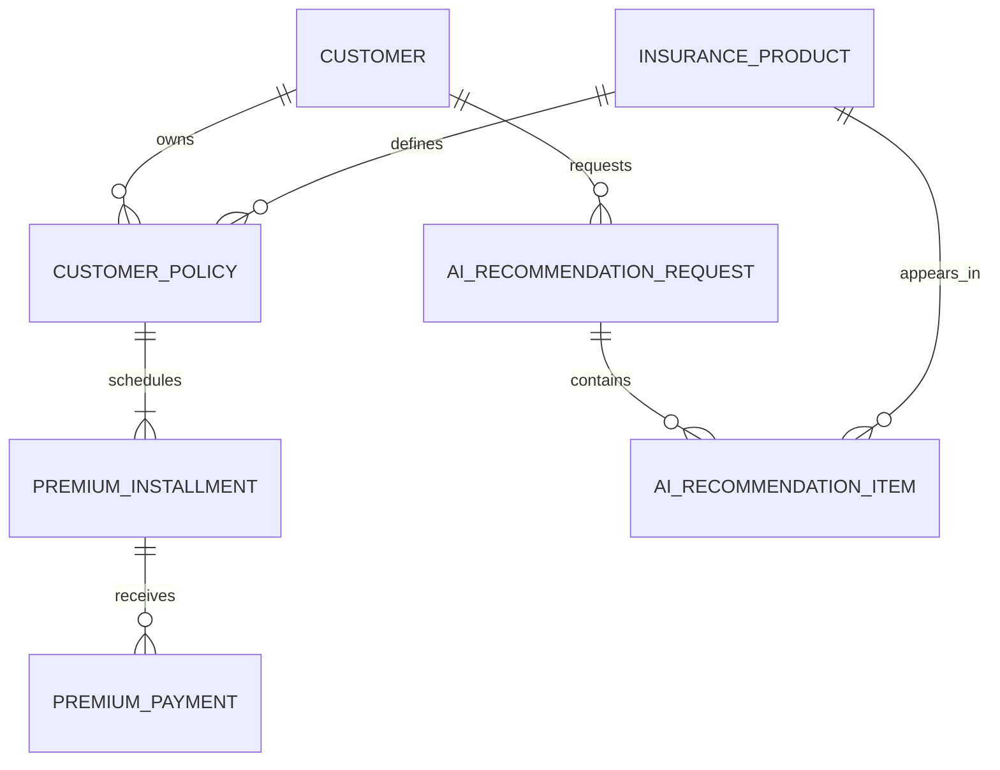

**5. Database Design**

**5.1 Database Design Principles**

Use PostgreSQL with normalized relational tables, explicit primary and foreign keys, unique constraints and indexes for frequently searched fields.

Use UUID or BIGINT identifiers consistently. Store money values as NUMERIC(19,2), dates as DATE and audit timestamps as TIMESTAMP WITH TIME ZONE.

Keep the insurance product catalog separate from registered policies. At registration, the policy snapshots premium frequency, premium amount, sum insured and total premium payable. The displayed policy term comes from the current catalog product.

Recommendation requests store customer preferences, calculated age, the model name and version, the prompt version and the request time. Recommendation items store the product, rank, rationale, suitability and registration selection. This audit covers completed requests, including empty results. Rendered prompts, the catalog sent to the model and failed model attempts are outside the stored audit scope.

Claim-related tables belong to the future enhancement scope and must not be required for the current assessment implementation.

**5.2 Current-Scope Database Tables**

The following logical tables support FR-1 through FR-5. Teams may adapt physical names while preserving the relationships, constraints and auditability described below.

| Table | Purpose | Key Columns | Core Constraints / Indexes |
|---------|---------|-------------|----------------------------|
| customer | Stores authenticated customer profile data. | customer\_id PK; email UQ; password\_hash; full\_name; date\_of\_birth; phone; status; created\_at; updated\_at | date\_of\_birth <= CURRENT\_DATE; status indexed |
| insurance\_product | Master catalog of insurance products. | product\_id PK; product\_code UQ; policy\_name; policy\_type; term\_months; premium\_frequency; premium\_amount; sum\_insured; min\_entry\_age; max\_entry\_age; active | premium\_amount > 0; sum\_insured > 0; active indexed |
| customer\_policy | Registered policy owned by a customer. | policy\_id PK; policy\_number UQ; customer\_id FK; product\_id FK; start\_date; maturity\_date; premium\_frequency; premium\_amount; sum\_insured; total\_premium\_payable; status; created\_at | UQ(customer\_id, product\_id) for the defined duplicate rule; customer\_id and status indexed |
| premium\_installment | Scheduled premium obligations for a policy. | installment\_id PK; policy\_id FK; installment\_number; due\_date; grace\_period\_end\_date; scheduled\_amount; assessed\_penalty\_amount; paid\_amount; payment\_status | UQ(policy\_id, installment\_number); assessed\_penalty\_amount ≥ 0; 0 ≤ paid\_amount ≤ scheduled\_amount + assessed\_penalty\_amount |
| premium\_payment | Immutable premium payment transaction history. | payment\_id PK; installment\_id FK; transaction\_reference UQ; payment\_date; amount\_paid; penalty\_amount; payment\_method; created\_at | amount\_paid > 0; installment\_id and payment\_date indexed |
| ai\_recommendation\_request | Captures a completed recommendation request. | recommendation\_request\_id PK; customer\_id FK; insurance\_goals; preferred\_term (nullable positive integer in months); preferred\_policy\_type; calculated\_age; model\_name; model\_version; prompt\_version; requested\_at | customer\_id and requested\_at indexed |
| ai\_recommendation\_item | Stores products returned for a recommendation request. | recommendation\_item\_id PK; recommendation\_request\_id FK; product\_id FK; rank\_order; recommendation\_reason; suitability; selected\_for\_registration | UQ(recommendation\_request\_id, product\_id); product must exist and be active at generation time |

**5.3 Entity Relationship Diagram**

The ER diagram shows the current implementation scope. One customer can own multiple policies and recommendation requests. A policy contains installments; each installment can have multiple payment transactions. Recommendations reference only products from the product master.

*Figure 1. HealthDekho current-scope database entity relationships*

**5.4 Future-Enhancement Database Tables**

The following tables are reserved for FE-1 and should be added only when AI-Assisted Claim Assessment and Approval is implemented.

| Future Table | Purpose | Key Columns |
|--------------|---------|-------------|
| insurance\_claim | Claim header and submitted claim information. | claim\_id PK; claim\_number UQ; policy\_id FK; customer\_id FK; claim\_date; claim\_amount; description; document\_status; claim\_status; submitted\_at |
| claim\_assessment | Separates deterministic validations from AI output. | assessment\_id PK; claim\_id FK; premium\_compliance; policy\_validity; document\_verified; ai\_summary; model\_name; model\_version; assessed\_at |
| claim\_decision | Records controlled approval or rejection. | decision\_id PK; claim\_id FK; final\_status; decision\_reasons; processing\_user\_id; decision\_timestamp |

